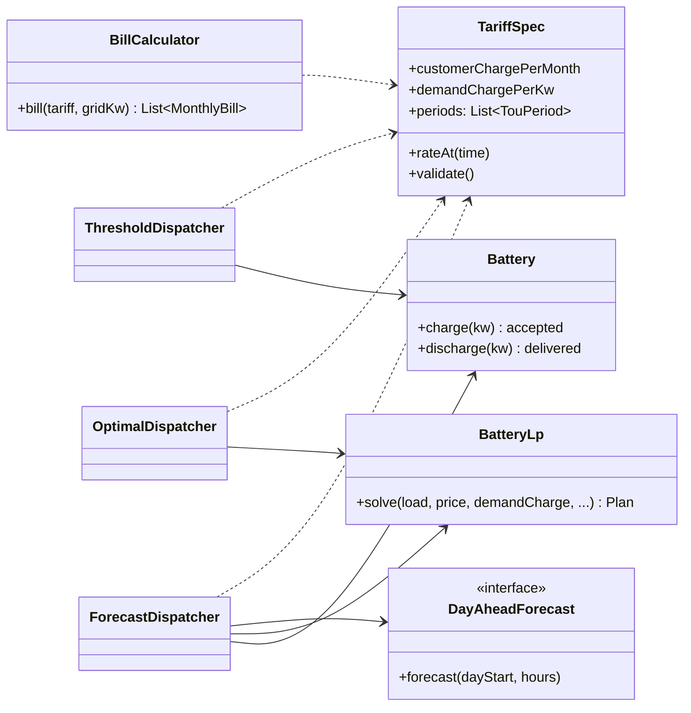
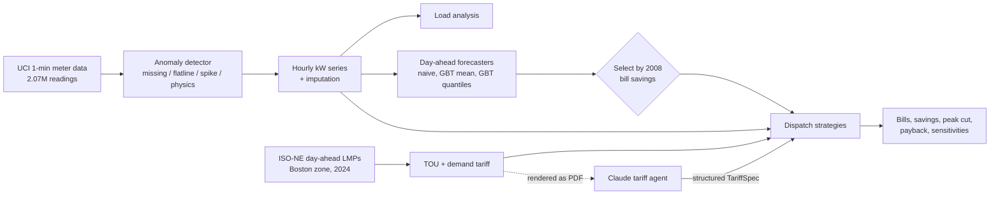
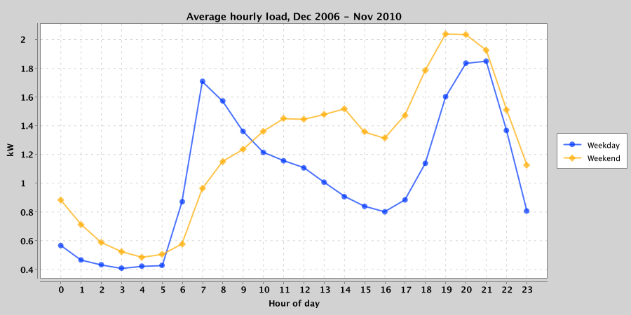
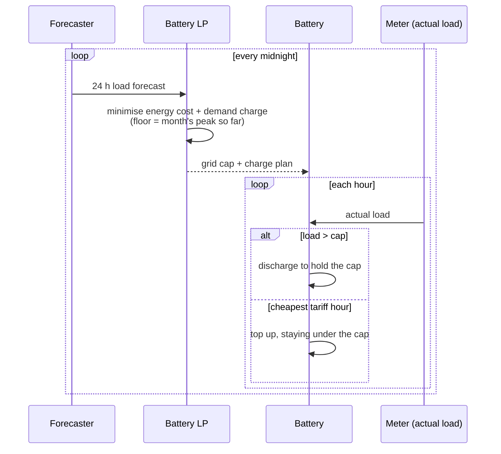
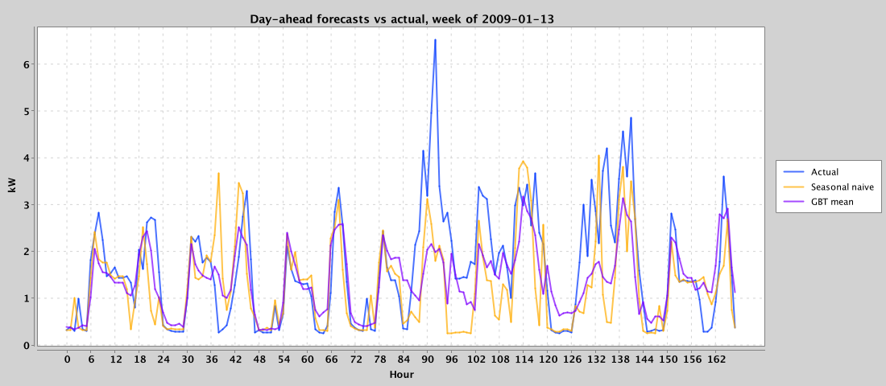
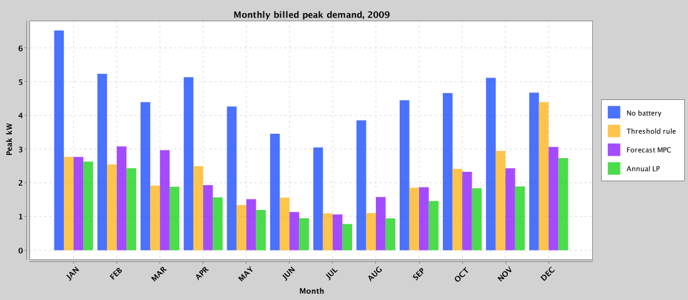
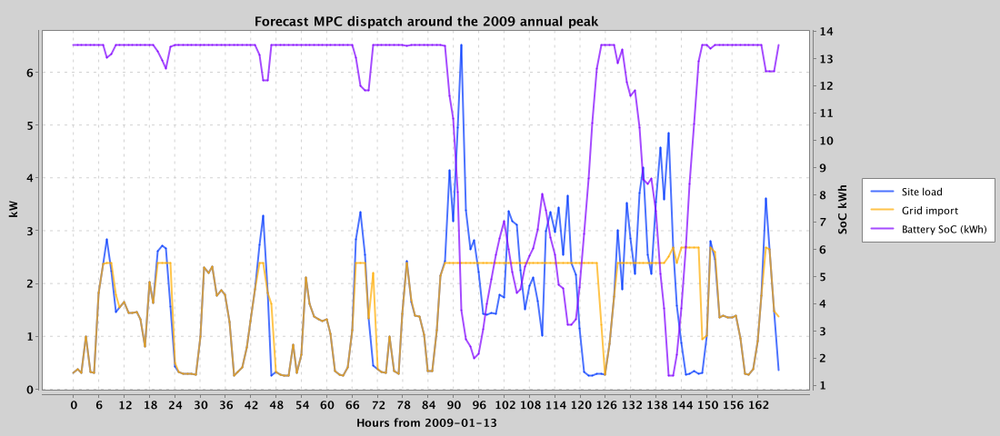
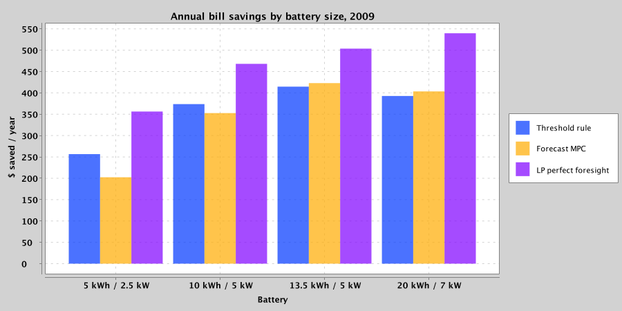
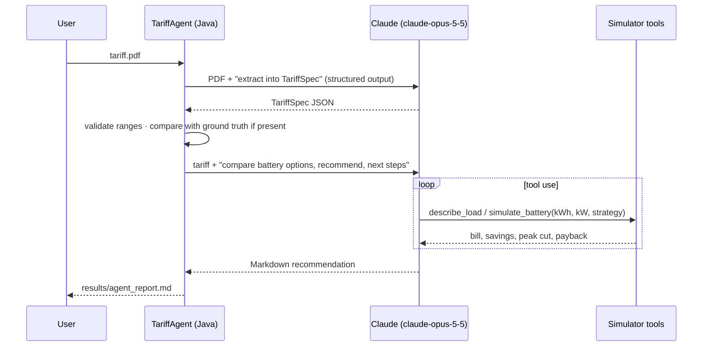

# VoltWise

Electricity billing, load analytics and battery peak shaving, in Java.

VoltWise started as a desktop electricity-bill generator (Swing + MySQL). This repo extends it into
an analytics engine that answers a practical question for one customer:

> **On a time-of-use tariff with a demand charge, how much can a home battery cut the bill, how should it be
> dispatched, and does it pay for itself?**

Everything runs on **real data**: 2 million one-minute meter readings from a household
(UCI) and a full year of hourly wholesale prices from ISO New England's Boston load zone.

| | |
|---|---|
| Meter data | 2,075,259 one-minute readings, Dec 2006 – Nov 2010 |
| Wholesale prices | 8,783 hourly day-ahead LMPs, ISO-NE `.Z.NEMASSBOST`, 2024 |
| Held-out test year | 2009 (rules tuned and models trained on earlier data only) |
| Peak demand cut, deployable controller | **53.1 %** (avg monthly billed peak 4.57 → 2.14 kW) |
| Annual bill savings, deployable controller | **$422.94 (17.1 %)** of a $2,479.14 baseline |
| Optimal (perfect-foresight LP) savings | $503.71 (20.3 %): the deployable controller captures 84 % of it |
| Battery payback (13.5 kWh at $1,000/kWh) | 31.9 years. Best case: a 5 kWh unit with perfect foresight, 14.0 years |
| Day-ahead forecast error (hourly MAPE) | 54.2 % GBT, 69.1 % seasonal naive (household load is spiky) |
| Meter anomaly detection | 96.3 % event recall, 99.97 % precision on 600 injected faults |
| Tests | 29 JUnit tests: battery limits, energy balance, bill maths, LP optimality, leakage |

---

## Contents

- [Architecture](#architecture)
- [Pipeline](#pipeline)
- [1. Meter data and anomaly detection](#1-meter-data-and-anomaly-detection)
- [2. Load analysis](#2-load-analysis)
- [3. Time-of-use tariff from wholesale prices](#3-time-of-use-tariff-from-wholesale-prices)
- [4. Battery model](#4-battery-model)
- [5. Dispatch strategies](#5-dispatch-strategies)
- [6. Forecasting](#6-forecasting)
- [7. Results](#7-results)
- [8. Tariff agent (Claude)](#8-tariff-agent-claude)
- [Running it](#running-it)
- [Assumptions and limitations](#assumptions-and-limitations)
- [Legacy desktop app](#legacy-desktop-app)

---

## Architecture

```
VoltWise/
├── src/electricitybillgenerator/        Legacy Swing + MySQL bill generator (NetBeans / Ant)
└── analytics/                           Maven module: the analytics engine (Java 21)
    ├── src/main/java/electricitybillgenerator/analytics/
    │   ├── data/        UCI loader, ISO-NE price fetcher, hourly aggregation + imputation
    │   ├── anomaly/     rule-based meter fault detector + injection benchmark
    │   ├── tariff/      TariffSpec (TOU + demand), wholesale→retail builder, bill calculator
    │   ├── battery/     battery spec and hour-step physics (limits, efficiency)
    │   ├── dispatch/    threshold rule, battery LP (ojAlgo), forecast MPC, perfect-foresight LP
    │   ├── forecast/    histogram gradient-boosted trees (mean + quantile), baselines, selection
    │   ├── agent/       Claude tariff-PDF extraction + tool-using what-if agent
    │   ├── report/      load statistics, strategy scoring, charts (XChart)
    │   ├── Experiment.java   the end-to-end study
    │   └── Main.java         CLI
    ├── src/test/java/   29 JUnit tests
    ├── data/            isone_da_lmp_2024.csv (committed), raw/ (UCI, downloaded)
    └── results/         metrics.json, charts/, sample_tariff.pdf
```



Every dispatcher sends its decisions through the same `Battery` object, which clamps every request
to the power limit and the state-of-charge window. No strategy can cheat the physics, and the tests
check energy balance hour by hour for every strategy.

## Pipeline



Train/validation/test split, strictly in time order:

```
 Dec 2006            Jan 2008            Jan 2009            Jan 2010    Nov 2010
    |───── history ─────|──── validation ───|─────── TEST ──────|── unused ──|
    |                   |                   |                   |
    |  forecaster fit   |  rule thresholds  |  every number in  |
    |  for validation   |  tuned; forecaster|  the results table|
    |                   |  chosen by $ saved|                   |
    |──────── forecaster refit for test ────|                   |
```

---

## 1. Meter data and anomaly detection

Bad readings get flagged before they reach billing. The rules are simple on purpose: a billing
dispute needs a reason ("the meter reported more power than V × I allows"), not an anomaly score.

| Rule | Fires when | Found in real data |
|---|---|---|
| `MISSING` | no reading | 71 gaps, 25,979 min (1.25 %) |
| `FLATLINE` | identical non-trivial reading for ≥ 3 h (stuck register) | 1 event, 401 min |
| `SPIKE` | one minute jumps > 4 kW above both neighbours, or > 12 kW service limit | 0 |
| `PHYSICS` | active power > apparent power (V × I), or voltage outside 230 V ± 10 % | 24 events, 57 min |

Flagged minutes are dropped. An hour needs at least 30 good minutes; otherwise it's imputed from the
same hour one week earlier (then one day earlier, then one week later). 438 of 34,587 hours (1.3 %)
were imputed.

**Injection benchmark.** I injected 600 synthetic faults into minutes the detector already
considered clean. They're deliberately mixed in size, so some fall under the thresholds:
single-minute spikes of 1–9 kW, frozen registers of 1–8 h, and calibration faults that scale
power by 1.05–3× for 10–60 min.

| Metric | Value |
|---|---|
| Event recall | 96.3 % |
| Minute recall | 91.5 % |
| Minute precision | 99.97 % |
| False-alarm rate on clean minutes | 0.001 % (19 minutes) |

The missed events are the ones built to sit under the detector's thresholds: spikes under 4 kW,
freezes under 3 h, and calibration errors too small to violate V × I.

## 2. Load analysis



| Metric | Full dataset | 2009 |
|---|---|---|
| Energy | 37,671 kWh | 9,428 kWh |
| Average load | 1.09 kW | 1.08 kW |
| Peak hourly demand | 6.56 kW (23 Nov 2008, 18:00) | 6.52 kW (16 Jan 2009, 20:00) |
| Load factor (avg / peak) | 0.166 | 0.165 |
| Mean monthly load factor | 0.230 | 0.235 |
| Most common daily peak hour | 20:00 | 20:00 |
| Weekend / weekday energy | 1.19 | 1.21 |

A load factor around 0.17 is very peaky. The house averages about 1 kW but bills on 4–6 kW monthly
peaks, which is exactly the shape a demand charge punishes and a battery can flatten.

## 3. Time-of-use tariff from wholesale prices

`WholesaleTouBuilder` turns 8,783 hourly ISO-NE day-ahead prices into a retail TOU tariff:

1. Split into summer (Jun–Sep) and winter. Average the weekday price for each hour of the day.
2. **On-peak** is the most expensive contiguous 5-hour window. **Mid-peak** is the rest of the best
   11-hour window around it. Everything else, plus weekends, is **off-peak**.
3. Retail rate = the band's mean wholesale price + a $0.12/kWh delivery adder.
4. Add a $15/kW-month demand charge on the highest hourly kW, and a $10/month customer charge.

```
 Winter weekday ($/kWh)                         rate
 00 ─ 12  ░░░░░░░░░░░░░░░░░░░░░░░░ Off-Peak     0.1620
 12 ─ 16  ▒▒▒▒▒▒▒▒                 Mid-Peak     0.1625
 16 ─ 21  ██████████               On-Peak      0.1754   ← overlaps the household's 20:00 peak
 21 ─ 23  ▒▒▒▒                     Mid-Peak     0.1625
 23 ─ 24  ░░                       Off-Peak     0.1620
```

The derived on/off-peak spread is only about 1.3 ¢/kWh in winter and 3.2 ¢/kWh in summer, because New England wholesale prices are fairly
flat across the day. Once you take out 10 % round-trip losses, there's almost no value in energy
arbitrage. **The demand charge is where the money is**: $822 of the $2,479 baseline bill in 2009.

## 4. Battery model

Default battery: 13.5 kWh usable, 5 kW, 90 % round-trip efficiency (√0.9 each way), state of charge
limited to 10–100 %, starting at 50 %. Each hour:

```
          grid import  g = load + c − d        (never negative: no export)
                  │
   ┌──────────────▼──────────────┐
   │  c ≤ P_max      d ≤ P_max   │
   │  SoC' = SoC + η·c − d / η   │   η = √0.90
   │  SoC_min ≤ SoC' ≤ SoC_max   │
   └─────────────────────────────┘
```

## 5. Dispatch strategies

| Strategy | Knows the future? | How it works |
|---|---|---|
| **Threshold rule** | no | One threshold per calendar month, picked by grid search on **2008** bills. Discharge above it; recharge in the day's cheapest tariff hours without crossing it. |
| **Forecast MPC** | no (day-ahead forecast) | Each midnight: forecast 24 h, solve the battery LP on the forecast, and use the planned peak as the day's grid cap. Execute against the real load: discharge above the cap, top up in cheap hours. |
| Forecast MPC, perfect forecast | next 24 h only | Same controller, fed the real next-day load. Shows what better forecasting could add. |
| **Annual LP** | the whole year | One linear program over 8,760 hours with a separate peak variable per month. A true upper bound. |

The LP (solved with [ojAlgo](https://www.ojalgo.org/)):

```
minimise    Σ_t price_t · (c_t − d_t)  +  Σ_m D · P_m  +  ε Σ_t (c_t + d_t)

subject to  s_t = s_{t−1} + η c_t − d_t / η           energy balance
            load_t + c_t − d_t ≤ P_m(t)               P_m = billed peak of month m
            load_t + c_t − d_t ≥ 0                    no export
            0 ≤ c_t, d_t ≤ P_max,   s_min ≤ s_t ≤ s_max,   s_T ≥ s_0
```



**A design lesson from building this.** The first version of the MPC followed its plan literally,
including small arbitrage discharges in the evening. On this tariff, the evening price peak lands on
the household's load peak. When the forecast came in low, the battery was already half empty when the
real peak hit. With the mean-GBT forecast, that version saved **$81/yr**. Reserving the battery for peaks
(fill in cheap hours, skip arbitrage) raised the same forecast to **$324/yr** and the seasonal
naive forecast from $71 to **$423/yr**.

## 6. Forecasting

Day-ahead hourly load forecasts, issued at midnight using only data from before midnight. A test
corrupts the target day and checks that the forecast doesn't change.

- **Seasonal naive**: the same hour one week earlier.
- **7-day average**: the mean of the same hour over the past week.
- **Gradient-boosted trees**: histogram GBT written from scratch (LightGBM-style binning, depth 6,
  400 trees, subsampling), trained on log(1 + kW). Its 15 features: hour, weekday, weekend flag,
  month and day-of-year cycles, same-hour lags (24 h, 48 h, 168 h), 7-day same-hour mean, and the
  previous day's mean, max and last hour.
- **Quantile GBTs** (pinball loss, q = 0.75 / 0.90 / 0.95 / 0.98). Peak shaving needs to know how
  *high* the load could go, not its average.

**Choosing a forecaster by money saved, not by error.** Each candidate was trained on data before
2008, plugged into the MPC, and scored on 2008 bill savings. The best one was retrained up to 2009
and tested there.

| Forecaster | Hourly MAPE | WAPE | Daily-peak MAPE | Coverage¹ | MPC savings 2008 (val) | MPC savings 2009 (test) |
|---|---|---|---|---|---|---|
| **Seasonal naive** ✔ selected | 69.1 % | 52.0 % | 29.0 % | 50.4 % | **$425** | **$423** |
| 7-day average | 63.8 % | 44.1 % | 27.1 % | 59.1 % | $344 | $372 |
| GBT (mean) | **54.2 %** | **40.6 %** | 28.2 % | 55.7 % | $371 | $324 |
| GBT q = 0.75 | 84.5 % | 48.9 % | **20.0 %** | 74.0 % | $373 | $417 |
| GBT q = 0.90 | 142.4 % | 75.2 % | 28.0 % | 89.2 % | $405 | $377 |
| GBT q = 0.95 | 185.4 % | 98.8 % | 36.6 % | 94.1 % | $371 | $313 |
| GBT q = 0.98 | 247.2 % | 132.5 % | 48.9 % | 97.3 % | $325 | $226 |

¹ Share of hours where actual load ≤ forecast. A well-calibrated q-quantile model should be near q,
and the quantile models are (89 % for q = 0.90, 94 % for q = 0.95).

**Takeaways.**

- The GBT is the most accurate model (54 % MAPE against the naive model's 69 %), yet it was the
  *worst* controller input. A mean forecast smooths out exactly the spikes the battery has to catch.
- The naive forecast replays last week's real spikes. It's less accurate per hour, but it gives the
  controller a better sense of the day's risk.
- Hourly MAPE above 50 % is normal for a single household: one kettle or oven shifts the hour.
  Feeder- or building-level load is much smoother.
- With a perfect forecast the same controller saves $435, only $12 more than with the naive one.
  For this customer, better forecasting is worth little; the real gap is the month-long view
  ($504 for the annual LP).



## 7. Results

All results are on the held-out 2009 year, default 13.5 kWh / 5 kW battery, $15/kW demand charge.

| Strategy | Annual bill | Savings | Avg monthly billed peak | Peak cut | Demand charges | Energy charges | Battery throughput |
|---|---|---|---|---|---|---|---|
| No battery | $2,479.14 | – | 4.57 kW | – | $822 | $1,537 | – |
| Threshold rule (tuned on 2008) | $2,064.49 | $414.65 (16.7 %) | 2.20 kW | 51.8 % | $396 | $1,548 | 842 kWh |
| **Forecast MPC (selected forecaster)** | **$2,056.21** | **$422.94 (17.1 %)** | **2.14 kW** | **53.1 %** | $386 | $1,550 | 950 kWh |
| Forecast MPC, perfect day-ahead | $2,043.96 | $435.19 (17.6 %) | 2.06 kW | 54.9 % | $370 | $1,553 | 1,156 kWh |
| Annual LP, perfect foresight (bound) | $1,975.44 | $503.71 (20.3 %) | 1.69 kW | 63.0 % | $305 | $1,551 | 1,441 kWh |

Energy charges go slightly *up* under every strategy, because the battery's round-trip losses cost
more than the small TOU spread pays back. All of the savings come from the demand charge.





### Battery size and payback

Installed cost is assumed at $1,000/kWh. Payback is capital cost divided by 2009 savings, with no
discounting or degradation.

| Battery | Capex | Rule | Forecast MPC | LP bound | Payback (MPC) | Payback (LP) |
|---|---|---|---|---|---|---|
| 5 kWh / 2.5 kW | $5,000 | $257 | $202 | $356 | 24.7 yr | 14.0 yr |
| 10 kWh / 5 kW | $10,000 | $374 | $353 | $468 | 28.4 yr | 21.4 yr |
| 13.5 kWh / 5 kW | $13,500 | $415 | $423 | $504 | 31.9 yr | 26.8 yr |
| 20 kWh / 7 kW | $20,000 | $393 | $403 | $540 | 49.6 yr | 37.1 yr |



### Demand-charge sensitivity (13.5 kWh battery)

| Demand charge | Baseline bill | Forecast MPC savings | LP bound savings |
|---|---|---|---|
| $0/kW | $1,657 | −$2 | $6 |
| $5/kW | $1,931 | $132 | $159 |
| $10/kW | $2,205 | $278 | $331 |
| $15/kW | $2,479 | $423 | $504 |
| $20/kW | $2,753 | $568 | $676 |
| $25/kW | $3,027 | $714 | $849 |

**Bottom line.** The controller does its job: it cuts the billed peak by more than half and gets
84 % of the theoretical optimum without seeing the future. Even so, a home battery does **not** pay
for itself on this customer's bill alone at today's installed cost. Savings scale almost linearly
with the demand charge and vanish without one. The same engine pointed at a commercial customer
(higher demand charges, smoother load, larger peaks) is where peak shaving pays off.

---

## 8. Tariff agent (Claude)

`agent` turns a utility rate-sheet PDF into a priced recommendation in two stages:



- **Extract.** The PDF goes to Claude as a document block. Structured output is bound to the
  `TariffSpec` record, so the reply parses straight into the same type the simulator uses.
  `TariffSpec.validate()` rejects implausible values (for example, a rate written in cents instead
  of dollars) before anything trusts them.
- **Check.** `sample-tariff` writes the derived tariff as a utility-style PDF, plus a
  `.truth.json`. `ExtractionCheck` prices every hour of a year with both tariffs and reports the
  share that match, which catches mistakes in rates, hours, months and period order in one number.
- **Analyse.** Using the SDK's tool runner, Claude calls `DescribeLoad` and `SimulateBattery`
  (rule, forecast or optimal strategy, any size) and writes a recommendation with a configuration
  table, payback and next steps, citing only numbers the tools returned.

You need an API key to run it (`ANTHROPIC_API_KEY`, or a profile from `ant auth login`):

```bash
java -jar target/peakshave.jar sample-tariff --out results/sample_tariff.pdf
java -jar target/peakshave.jar agent --pdf results/sample_tariff.pdf
```

---

## Running it

Requirements: JDK 21 and Maven.

```bash
cd analytics

# 1. Data: UCI household power (~127 MB unzipped)
mkdir -p data/raw && cd data/raw
curl -LO "https://archive.ics.uci.edu/static/public/235/individual+household+electric+power+consumption.zip"
unzip individual+household+electric+power+consumption.zip && cd ../..

# 2. Prices are committed (data/isone_da_lmp_2024.csv). To refetch from ISO-NE:
#    java -jar target/peakshave.jar fetch-prices --year 2024 --location .Z.NEMASSBOST

# 3. Build, test, run (the full study takes about 45 s)
mvn package
java -Xmx6g -jar target/peakshave.jar run
```

Options for `run`: `--demand-charge 15 --delivery-adder 0.12 --customer-charge 10 --battery-cost 1000`.
Results go to `results/metrics.json` and `results/charts/`.

Tests (`mvn test`, 29 tests) cover:

| Area | What's checked |
|---|---|
| Battery | power and SoC limits, efficiency on both legs, 100k random requests never break limits |
| Every dispatcher | per-hour energy balance, power limits, SoC window, no grid export |
| LP | shaves an isolated spike exactly; never beaten by the rule or the MPC |
| Billing | hand-computed bill (TOU energy + demand + customer charge), month splitting, savings maths |
| Tariff | period precedence, weekends, wholesale band placement, validation of bad extractions |
| Forecasting | GBT learns a nonlinear function, q = 0.9 model covers ~90 %, no look-ahead leakage |
| Data | loader gap-filling, hourly aggregation and imputation, ISO-NE parser incl. DST "02X" hour, each anomaly type |

## Assumptions and limitations

- **Mismatched sources.** The load comes from a house near Paris (2006–2010); the prices come from
  Boston (2024). The tariff only depends on season, weekday and hour, so the dates don't need to
  line up, but this is a modelling exercise, not one real customer's bill.
- **Assumed rates.** The demand charge ($15/kW-month), delivery adder and battery cost are my
  assumptions, so the sensitivity tables are included. Residential demand charges exist but aren't
  common.
- **Hourly resolution.** Demand is billed on hourly averages. Many tariffs use 15-minute intervals,
  which would make peaks higher and a battery more valuable.
- **Not modelled.** Battery degradation, discounting, incentives and export credits.
- **Forecast inputs.** The forecasters see only past load. Weather would help, but the UCI dataset
  has none.

## Legacy desktop app

`src/electricitybillgenerator/` is the original NetBeans Swing application: customer records in
MySQL (`ebillgen` database) and a bill screen that applies flat per-unit charges (energy, wheeling,
duty, tax). It's kept as is; the analytics engine replaces its flat-rate model with interval-based
TOU and demand billing.

Data sources: [UCI Individual Household Electric Power Consumption](https://archive.ics.uci.edu/dataset/235/individual+household+electric+power+consumption)
(CC BY 4.0) · ISO New England day-ahead hourly LMP reports (`https://www.iso-ne.com/histRpts/da-lmp/WW_DALMP_ISO_YYYYMMDD.csv`).
